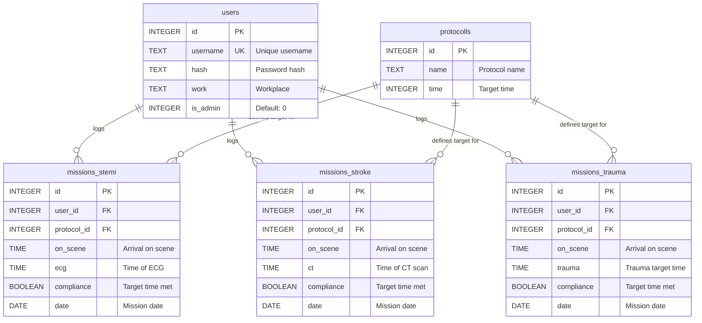

# SOP Compliance Tracker
#### Video Demo: <https://youtu.be/hW9mcUQGxoM>

## Overview
The SOP Compliance Tracker is a full-stack web application for out-of-hospital/ emergency medicine research. It is designed for emergency medical services (EMS) personnel and administrators to log, monitor, and evaluate time-critical rescue missions. In pre-hospital emergency care—specifically for **STEMI** (heart attack), **Stroke**, and **Trauma** protocols—strict adherence to Standard Operating Procedure (SOP) timeframes is critical for patient outcomes. This application enables responders to record key mission timestamps and automatically evaluates whether target intervention times were met, visualizing performance metrics through interactive dashboards.
### Description:
 It is a tool to acquire data from EMTs or Paramedics with as little effort as possible for the user. The data collection is supposed to happen immediately after a rescue mission and should therefore not take up a long time. The idea is to acquire the relevant data with the lowest possible threshold for high levels of participation. The website can be customized to address various research questions; the demo version examines the issue of SOP/ guideline compliance for in this case STEMI, stroke and trauma assessments. SOPS or guidelines often specify clear time limits by which a measure, intervention, or similar action must be taken. This web application allows participants to easily enter timestamps, which they can retrieve from their own records as needed. In the background, this data is stored, checked for compliance, and analyzed. The results are then displayed on an interactive dashboard. Both data entry and data display are organized according to the respective SOPs/guidelines to ensure a clear structure. For data protection reasons, regular users can only view the analysis of their own data, while administrators can view the analysis of all data.

## Features
* **User Authentication & Security:** Users can register for a new account, log in, and log out securely. Passwords are never stored in plain text; instead, the application uses cryptographic hashing (`werkzeug.security`) to protect user credentials. Session management (`flask_session`) ensures that only registered users can input data and only their own personal data is shown.

* **Protocol-Specific Mission Logging:** Logged-in users can add data from missions (date of the mission and two relevant timestamps). Each entry is immediately saved to the SQLite database (`project.db`), analyzed and then displayed on the dashboard. The process is carried out separately for each SOP to prevent data from being mixed up. There are dedicated input workflows for **STEMI** (On-Scene to ECG), **Stroke** (On-Scene to CT), and **Trauma** (On-Scene to Trauma Bay).

* **Intelligent Plausibility & Midnight-Rollover Checks**: Automatically detects when a secondary timestamp is numerically earlier than the arrival time (`time2 < time1`), triggering an interactive confirmation modal (`<dialog>`) to distinguish accidental typos from legitimate midnight rollovers.

* **Automated Compliance Calculation**: Dynamically compares elapsed mission durations against target timeframes stored in the database.

* **Interactive Analytics Dashboards**: Displays real-time Key Performance Indicators (total missions, compliant missions, color-coded compliance rates) alongside 7-day mission frequency bar charts powered by **Chart.js**.

* **Role-Based Access Control (RBAC) & Admin Filtering**: Differentiates between standard responders (who can only view their own mission records) and administrators, who can dynamically filter dashboard metrics by user and workplace.

* **One-Click CSV Data Export**: Enables administrators to export filtered protocol datasets directly as downloadable `.csv` files for offline analysis, external reporting or quality management audits.

* **Fully Responsive Design**: Adapts seamlessly to different screen sizes—from smartphones and tablets used in emergency vehicles to desktop monitors at the station.


## Tech Stack
* **Backend**: Python 3, Flask, Flask-Session (filesystem), CS50 SQL, Werkzeug Security
* **Database**: SQLite3
* **Frontend**: HTML5, Jinja2, Bootstrap 5, Custom CSS, Vanilla JavaScript (`fetch` API)
* **Data Visualization**: Chart.js (v4.4.1, locally hosted)

## Project Structure

```text
├── app.py                 # Main Flask application, routes, and REST API endpoints
├── helpers.py             # Utility functions (error handling, login decorator, time compliance)
├── seed.py                # Database seeding script for demo accounts and sample mission data
├── project.db             # SQLite database storing users, protocols, and mission logs
├── static/
│   ├── chart.js           # Locally hosted Chart.js v4.4.1 library
│   └── styles.css         # Custom styling (sticky header, typography, buttons)
└── templates/
    ├── layout.html        # Base Jinja2 template with navigation and Bootstrap setup
    ├── index.html         # Main landing hub after authentication
    ├── input.html         # Protocol selection menu
    ├── stemi_input.html   # STEMI mission entry form & async validation script
    ├── stroke_input.html  # Stroke mission entry form & async validation script
    ├── trauma_input.html  # Trauma mission entry form & async validation script
    ├── stemi.html         # STEMI KPI dashboard & Chart.js visualization
    ├── stroke.html        # Stroke KPI dashboard & Chart.js visualization
    ├── trauma.html        # Trauma KPI dashboard & Chart.js visualization
    ├── login.html         # User login view
    ├── register.html      # User registration view (including workplace selection)
    └── error.html         # Standardized HTTP error display
```

### Backend Architecture (`app.py`)

The backend is built with **Flask** and uses **SQLite** (via the CS50 SQL library) for persistent storage alongside **Flask-Session** (filesystem-based) for user authentication. The architecture separates HTML template rendering from JSON-based REST endpoints to enable dynamic, asynchronous frontend interactions.

#### Key Architectural Highlights

* **Authentication, Registration & Role Management**:
  * User registration (`/register`) validates inputs, enforces password confirmation, captures the user's workplace (`work`), hashes passwords via `werkzeug.security.generate_password_hash`, and prevents duplicate usernames.
  * During login (`/login`), credentials are verified with `check_password_hash`, and both `user_id` and a boolean `is_admin` flag (derived from the database) are stored in the server-side session.
  * Protected routes are secured via a custom `@login_required` decorator, and `@app.after_request` headers prevent browser caching of sensitive pages.
* **Asynchronous Mission Logging & Validation**:
  * Mission submission routes accept JSON payloads via `POST` requests.
  * **Midnight-Rollover / Plausibility Check**: If the secondary timestamp (`ecg`, `ct`, or `trauma`) is numerically smaller than `on_scene`, the backend returns a `show_warning` status, requiring explicit user confirmation (`force_insert`) before committing to the database.
  * **Automated Compliance Evaluation**: Dynamically queries target timeframes from the `protocolls` table and delegates time-delta evaluation to the `compliance()` helper function.
* **Dynamic Dashboard APIs & Server-Side Data Isolation**:
  * Dedicated `/api/*-data` endpoints calculate Key Performance Indicators (total missions, compliant missions, and formatted compliance rates) as well as 7-day mission frequency series for frontend charts.
* **In-Memory CSV Generation**: Uses Python's built-in `csv` and `io.StringIO` modules alongside a protocol whitelist to safely generate filtered CSV downloads without writing temporary files to disk.
* **Backend Security Enforcement**: Non-admin users are strictly restricted to viewing their own mission records. Even if query parameters (`user_id`, `workplace`) are manipulated on the client side, the backend overrides them for non-admin sessions, whereas administrators can filter data across all users and workplaces.

#### Route Overview

| Route | Methods | Description |
| :--- | :--- | :--- |
| `/` & `/input` | `GET` | Renders the main landing page and the medical protocol selection menu. |
| `/stemi_input`, `/stroke_input`, `/trauma_input` | `GET`, `POST` | Renders protocol-specific input forms (`GET`) and validates/inserts JSON mission logs into SQLite (`POST`). |
| `/stemi`, `/stroke`, `/trauma` | `GET` | Renders the analytics dashboard views, passing filter options (`users`, `workplaces`) when `is_admin` is active. |
| `/api/stemidashboard-data`, `/api/strokedashboard-data`, `/api/traumadashboard-data` | `GET` | REST endpoints returning aggregated KPI metrics and 7-day chart datasets as JSON based on user permissions and active filters. |
| `/export/<protocol>` | `GET` | Admin-only endpoint generating a filtered `.csv` file download for the selected protocol. |
| `/register` | `GET`, `POST` | Registers new users with hashed passwords and workplace (`work`) assignment (defaulting to non-admin). |
| `/login` & `/logout` | `GET`, `POST` | Authenticates users, initializes `user_id` and `is_admin` session variables, and handles session termination. |

### Helper Functions (`helpers.py`)

The `helpers.py` module encapsulates reusable utility functions for error handling, route protection, and medical time-compliance calculations.

* **`error(message, code=400)`**: Renders a standardized `error.html` template displaying a custom error message alongside the corresponding HTTP status code.
* **`login_required(f)`**: A custom route decorator (using `functools.wraps`) that verifies an active `user_id` in the server-side session, automatically redirecting unauthenticated visitors to `/login`.
* **`compliance(timestamp1, timestamp2, time)`**: Evaluates whether a medical intervention met the protocol's target timeframe:
  * Parses `"HH:MM"` time strings into `datetime` objects and computes the elapsed duration in minutes.
  * **Midnight-Rollover Handling**: Detects negative day deltas (`difference.days < 0`) when a mission spans across midnight (e.g., `23:50` to `00:05`) and adds `timedelta(days=1)` to compute the accurate elapsed time.
  * Compares the resulting duration against the protocol's target threshold (`time[0]["time"]`), returning `True` if compliant and `False` otherwise.

### Static Assets (`static/`)

* **`chart.js` (v4.4.1)**: Locally hosted open-source Chart.js library (MIT License) used to render interactive, responsive HTML5 canvas charts on the STEMI, Stroke, and Trauma dashboards without relying on external CDN requests.
* **`styles.css`**: Custom CSS stylesheet providing a clean, accessible user interface:
  * **Sticky Navigation Header**: Uses Flexbox (`position: sticky`) to keep navigation links (`nav-links`) anchored at the top with subtle elevation (`box-shadow`).
  * **Readable Typography**: Styles body copy with a modern system font stack (`system-ui`), `1.6` line height, and an optimal `85ch` maximum line width.
  * **Consistent UI Components**: Defines reusable button styles (`.btn`) with hover state transitions.


### Frontend Templates (`templates/`)

The frontend uses **Jinja2** templating built on top of a shared base layout (`layout.html`) to maintain consistent navigation and styling across all views.
* **Responsive Layout & Styling**: Built with **Jinja2** inheritance (`layout.html`), **Bootstrap 5**'s responsive grid system (`col-12`, `col-md-4`, `col-xl-9`), and custom CSS (`styles.css`), ensuring layouts, KPI cards, and Chart.js canvases automatically scale across mobile, tablet, and desktop viewports.


#### Base & General Views
* **`layout.html`**: Master template defining the HTML boilerplate, sticky navigation header, global stylesheet (`styles.css`), and Jinja2 content blocks.
* **`index.html`**: Main landing page after login, serving as the central hub to navigate between mission logging and analytics dashboards.
* **`input.html`**: Protocol selection menu allowing users to choose between STEMI, Stroke, and Trauma mission entry forms.
* **`error.html`**: Standardized error page displaying HTTP status codes and descriptive error messages returned by the backend.

#### Authentication Views
* **`login.html`**: User authentication form for username and password submission.
* **`register.html`**: Account creation form capturing username, password confirmation, and the user's workplace (`work`).

#### Protocol-Specific Mission Input Forms
* **`stemi_input.html` / `stroke_input.html` / `trauma_input.html`**: Interactive forms styled with Bootstrap utility classes for logging mission dates and critical timestamps (`on_scene` vs. `ecg`, `ct`, or `trauma`). Instead of traditional page reloads, an embedded script intercepts form submission via `fetch` to send JSON payloads asynchronously. If the backend detects a potential midnight rollover (`time2 < time1`), the page opens a native HTML `<dialog>` modal (`confirmPopup`), allowing the user to either cancel and reset the form or confirm the overnight mission (`force_insert: true`).

#### Analytics Dashboards
* **`stemi.html` / `stroke.html` / `trauma.html`**: Protocol-specific performance dashboards displaying key metrics (total missions, compliant missions, compliance rate) and 7-day mission trend charts powered by **Chart.js**. For administrators (`is_admin`), these templates dynamically render filter controls to segment data by user or workplace as well as a one-click CSV export button.

## Database Schema
The application uses an SQLite database (`project.db`) to manage user accounts, protocol target times, and logged emergency missions (STEMI, Stroke, Trauma).



### Table Overview
* **`users`**: Stores login credentials, workplace (`work`), and administrator privileges (`is_admin`).
* **`protocolls`**: Defines the medical protocols along with their respective target times (`time`).
* **`missions_stemi` / `missions_stroke` / `missions_trauma`**: Records individual missions, key timestamps (`on_scene`, `ecg`, `ct`, `trauma`), and whether the target time was met (`compliance`).

## Design Decisions

* **Minimalist, Distraction-Free UI**: Emergency medical documentation often happens under high time pressure. Instead of complex menus or visual clutter, the interface prioritizes high contrast, readable typography (`system-ui`), clear input forms, and immediate visual feedback (such as color-coded compliance rates at the `80%` threshold) so responders can log timestamps in seconds.
* **Cross-Device Responsive Layout**: Emergency personnel access the application across varied hardware—ranging from smartphones and rugged tablets in ambulances to desktop workstations at the hospital or dispatch center. Using Bootstrap 5's responsive grid system alongside `Chart.js`'s `maintainAspectRatio: false` container scaling ensures full usability on any viewport without horizontal scrolling.
* **Locally Hosted `Chart.js` (Zero External CDN Dependencies)**: Rather than loading Chart.js from a third-party CDN, `chart.js` (v4.4.1) is bundled directly inside `static/`. During development in restricted sandboxed workspaces (such as CS50 Codespaces) and in real-world EMS environments with intermittent mobile connectivity, external CDN requests can fail or be blocked. Bundling the library locally guarantees offline reliability, faster load times, and zero external dependencies.
* **Separate Tables per Protocol**: Instead of a single polymorphic table with nullable columns, STEMI, Stroke, and Trauma missions are stored in dedicated tables (`missions_stemi`, `missions_stroke`, `missions_trauma`). This enforces strict `NOT NULL` constraints on protocol-specific timestamps (`ecg`, `ct`, `trauma`) directly at the database level.

## Setup & Usage (How to Run):
1. Clone the repository
2. Install dependencies: `pip install -r requirements.txt`
3. *(Optional)* Populate the database with guideline-aligned demo data (10 min STEMI, 70 min Stroke, 60 min Trauma):
   ```bash
   python seed.py
   ```
4. Start the application: `flask run`

### Demo Accounts
If you run `seed.py`, you can immediately test the application using the following pre-configured accounts:
* **Administrator** (full access, user/workplace filters, CSV export):
  * **Username:** `admin` | **Password:** `admin123`
* **Standard User** (restricted to personal mission records):
  * **Username:** `paramedic_max` | **Password:** `demo123`

## AI Usage Disclosure

In accordance with academic honesty guidelines, AI tools (such as CS50 DuckDebugger, Gemini, Perplexity) were used during the development of this project as an assistive learning and productivity tool. Specifically, AI was utilized for:
* Generating the standalone database seeding script (`seed.py`) to populate the database with demo accounts and randomized, guideline-aligned sample missions for testing and demonstration purposes.
* Brainstorming backend structure and debugging edge cases (e.g., midnight-rollover time calculations and dynamic SQL query filtering).
* Assisting with frontend JavaScript (`fetch` API integration and Chart.js configuration) and Bootstrap layout refinements.
* Structuring and translating technical documentation for this `README.md`.

The original project concept, fundamental application architecture, and database design are entirely the author's own work, and all AI-assisted code and suggestions were thoroughly reviewed, adapted, and verified by the author.

## License & Copyright
Copyright (c) 2026 Tanja Stockhaus. All rights reserved.
